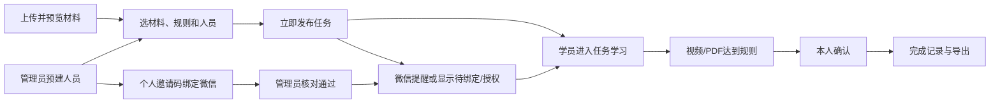
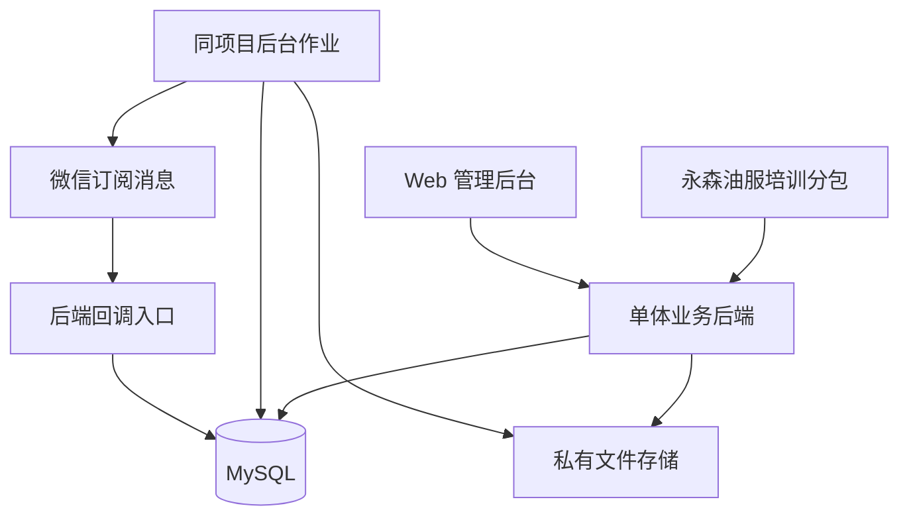

# 01 产品与架构：MVP 1.0

> 本文保留初始产品与设计基线；其中容量目标、部署建议和账号准备状态不代表当前验收结果。当前代码结构与实际部署请先阅读 [13 架构和部署总览](13-project-architecture-and-deployment.md)，发布证据见 [12 云部署记录](12-cloud-deployment-status.md)。

2026年10月17日。根据用户补充，使用现有“永森油服”账号，从零建立本地工程；[学习判定与消息规则](02-learning-and-notification.md)、[数据和接口](03-data-and-api.md)、[验收清单](04-delivery-and-acceptance.md)共同构成实施基线。已实现接口的准确字段与路径见 [运行契约](runtime-api.md)，启动及账号接入见 [运行说明](05-local-and-wechat-setup.md)。

## 1 目标与范围

管理员向指定人员下发任务并通过个人微信提醒；学员完成视频/PDF 学习和本人确认；管理员能查到谁在什么时间学习了什么、系统如何判断完成，并导出记录用于客户或安全审核。

| 编号 | 必须具备的能力 | MVP 实现 |
| --- | --- | --- |
| FR-01 | 人员与身份绑定 | 管理员预建人员；个人邀请码绑定微信，管理员核对；停用和换绑留痕 |
| FR-02 | 学习材料 | 上传、预览 MP4/PDF；校验文件哈希；PDF 生成页图用于受控阅读 |
| FR-03 | 任务下发 | 直接选择材料、规则和人员，立即发布；固定名单与内容；截止时间及取消 |
| FR-04 | 微信通知送达 | 发布首次通知、管理员手动催办；真实微信收件并进入任务；追踪回执、打开和失败原因 |
| FR-05 | 学习与续学 | 视频区间覆盖、PDF 逐页查看和停留；前台检查；中断后继续或补学 |
| FR-06 | 本人确认 | 全部材料达标后主动确认，服务端复检并生成完成记录 |
| FR-07 | 查询与导出 | 按任务查看人员进度、导出 CSV；单人记录打印页可由浏览器保存 PDF |
| FR-08 | 基础保障 | 对象权限、过程日志、操作审计、备份恢复和故障提示 |

首期不建设独立课程平台、在线考试、现场考核业务、多级审批、定时发布、自动到期提醒、外部审核门户或第三方存证。任务就是一次培训安排，不增加课程版本和培训计划等管理层级。

## 2 两类角色

| 角色 | 权限 |
| --- | --- |
| 管理员 | 管理人员、核对绑定、上传材料、发布/取消任务、手动催办、查询/导出记录、配置模板 |
| 学员 | 绑定本人身份，查看本人任务，订阅提醒，学习、确认，查看本人记录 |

单企业部署，管理员查看本企业培训数据；单位/项目作为人员字段和筛选条件，不引入多租户或复杂组织权限。后端校验每次访问的人员归属，猜中 ID 也不能访问他人任务或文件。管理账号采用成熟认证组件，具备密码安全存储、会话过期和登录限流。

## 3 业务闭环



### 3.1 人员绑定

管理员逐人录入姓名、唯一人员编号，单位/项目可选，首期不做 Excel 导入。每人生成至少 128 位随机、单次使用、默认 7 天有效的邀请码，数据库仅存摘要；管理员通过已有联系渠道把个人入口交给对应人员。

学员微信登录后提交邀请码，进入待核对状态；管理员依据名册或线下联系核对并批准，绑定当前 AppID 下的 OpenID。邀请码提交成功即失效，被拒绝后需重新生成。一个人只有一个有效绑定，一个 OpenID 只能绑定一个人；核对过程不能宣称公安实名认证。

停用或换绑要求原因并终止旧会话；历史学习仍保留当时的绑定标识。换绑后可继续该人员原任务。人员可先被分配任务，再完成绑定；批准后显示其未取消任务。未绑定/未订阅的通知显示原因，条件补齐后重新检查原首次待发通知；这属于首次发送，不新增自动到期催办。

### 3.2 材料和发布

只接受 MP4/PDF。视频必须是真机兼容编码，服务端提取时长与编码；不兼容则提示重新导出，首期不转码。PDF 必须无密码且完整可渲染，生成页图和固定可读区域，管理员预览无缺页、模糊或裁切后方可使用。PDF 页图生成属于阅读实现；Word/PPT 由管理员自行先转成 PDF。

建议上传限额：单视频 500 MB/60 分钟、单 PDF 50 MB/100 页，任务最多 10 份材料、500 名人员；这些是待验证的可配置产品限制。保存原文件和页图哈希；被任务引用后不可覆盖或删除，更新时上传新材料。

任务字段为标题、说明、截止时间（可选）、有序材料清单、阅读时长和指定人员。所有材料必学；视频固定 1 倍速并要求完整覆盖，PDF 默认每页 30 秒且覆盖全部可读区域。规则默认值用于试点，不作为法定学时。

发布前展示材料、规则、名单、总人数及当前具备通知条件人数。发布事务固定文件哈希、时长/页数、规则版本、人员快照，并创建个人任务和首次通知待办；重复发布请求不能重复分配。发布后不再修改材料、规则和名单，遗漏人员或更新材料通过新任务安排。截止后仍可补学并显示逾期。

### 3.3 学习与确认

视频按有效播放区间去重，PDF 按页记录可见时长和区域覆盖。切后台、暂停、加载失败或长时间网络中断停止计时；恢复时从已确认进度继续，遗漏部分提示补学。页面显示服务端已确认进度，不将本地计时直接当成完成。

全部材料达标后展示声明：“我确认由本人完成本任务所列材料的学习，并已阅读任务要求。”学员主动勾选提交，服务端重新检查任务、人员和学习进度，记录声明版本与确认时间。前端无权提交完成率或直接改为完成；管理员没有强制完成或修改学习时长入口，异常通过补学处理。

结论统一为“已完成本任务学习要求”。行为日志支持追溯，不绝对证明本人持续专注，也不自动证明理解、考试或实操合格。完整算法见文档 02。

## 4 页面与操作

### 4.1 小程序：5 个业务页面

当前没有需要接入的旧源码，因此从零建立五页原生小程序，以“我的学习任务”为入口；使用现有“永森油服”账号的 AppID 接入。管理员操作放在独立 Web 后台，本地浏览器学员预览仅用于开发验收。

| 页面 | 必备内容 |
| --- | --- |
| 身份绑定 | 微信登录、邀请码、待核对/已通过/拒绝状态、本人信息、隐私说明；通过后可主动订阅任务通知 |
| 我的任务 | 待学习、学习中、待确认、已完成；截止与逾期提示；完成项作为记录入口 |
| 任务详情 | 材料清单、已确认进度、规则、订阅提醒、本人确认及补学提示 |
| 学习页面 | 按类型显示视频或 PDF；已确认进度、待同步状态、继续/补学位置 |
| 个人记录 | 人员和任务信息、材料与规则、学习结果、本人确认和完成时间 |

订阅按钮放在绑定通过页及任务详情，由学员主动点击触发微信授权，便于在管理员后续发布任务前取得发送条件；拒绝订阅仍可学习，不把授权弹窗伪装为任务确认。一次性订阅被使用后需学员再次主动授权，不能承诺任意次数推送。

```text
永森油服 · 学习任务
任务：作业现场安全学习        截止：10月20日18:00
状态：学习中
视频  作业风险识别           已确认 63%
PDF   作业操作规程           已完成 5/12 页
[继续学习]  [订阅微信提醒]
全部材料达标后可进行本人确认。
```

### 4.2 管理后台：4 个模块

| 模块 | 必备操作 |
| --- | --- |
| 人员 | 新增/编辑、筛选、邀请码、绑定核对、停用/换绑 |
| 材料 | 上传、处理状态、预览、错误原因；已引用材料只读 |
| 任务 | 创建/发布预览、列表/详情、人员进度、通知结果、催办、取消、CSV、单人打印 |
| 设置 | 模板及字段映射、接入状态；密钥通过部署配置管理，不回显 |

任务详情显示人员编号、姓名、单位、状态、完成材料数、确认时间、逾期与通知结果；点击人员查看各材料覆盖、有效时长及最后学习时间。无需独立通知中心、档案中心或复杂工作台。

## 5 状态与导出

任务状态为 `DRAFT → ACTIVE → CANCELLED`。取消停止后续学习、确认和新通知，但不删除已有记录；新导出同时显示取消原因/时间和原完成事实。首期不设自动关闭。

个人状态为 `NOT_STARTED → IN_PROGRESS → READY_TO_CONFIRM → COMPLETED`；最后一步必须本人确认且服务端检查通过。逾期独立派生，完成时固定是否逾期。

微信通知必须完成实际发送和任务跳转，送达属于 MVP 范围。后台将接口接受、微信回执和用户打开分开展示：只有可可靠关联的成功回执才能标为微信确认送达；缺回执或不能关联时显示送达未确认，用户通过通知进入则单独记打开时间。未绑定、未授权和明确失败均展示原因及处理入口，不能由接口成功推定已读或学习完成。

单人记录包含人员快照与核对方式、任务及截止时间、材料名称/哈希、固定规则、各材料覆盖与有效时长、开始/最后学习/确认/完成时间、确认声明、通知摘要、取消信息、记录编号与导出时间。打印页可由浏览器保存 PDF，不建设独立 PDF/ZIP 生成服务。

CSV 按任务汇总，防止公式注入，不输出 OpenID、邀请码或敏感原始日志。原材料、事件及确认记录保留供追溯，不能只保存完成布尔值。《安全生产法》第二十八条要求培训档案如实记录时间、内容、人员和考核结果；本系统只记录实际实现的学习部分，客户要求的考试/实操结果应由其现有流程提供。[法规原文](https://wb.flk.npc.gov.cn/flfg/texthtml/c4bbdc56233646b98d22c0e7915230b3.html)

## 6 最小架构



小程序从零采用微信原生框架；管理端 Vue + TypeScript，后端 Java 17 / Spring Boot 3.5.16，正式数据库 MySQL 8，本地默认文件 H2。依赖版本已锁定，不引入微服务、独立消息中间件或必选 Redis。

同一后端项目处理人员、材料、任务、学习、通知及导出，后台作业处理 PDF 页图和消息发送。通知待办随发布事务写库，再异步发送；学习事件、进度和单人会话互斥依靠数据库事务与唯一约束。

容量目标：500 人员、100 人同时学习，按 5 秒上报一次约 20 次学习请求/秒，属于待验收目标。文件在鉴权后提供短期访问地址，业务使用 HTTPS，微信密钥只在服务端。原始日志与确认记录在正常业务中只追加；每日数据库及材料备份并做恢复验证。文件哈希帮助发现变化，本身不等于第三方不可篡改存证。客户认可的记录内容、保存期限和清理策略在正式使用前确认。

## 7 现有账号接入

使用用户指定的“永森油服”小程序账号。用户已确认没有旧源码，当前工程从零开发；账号后台访问被浏览器安全检查阻止，因此实际 AppID、类目、模板和域名尚未核验。真实联调前按文档 04、05 完成账号接入检查，不能把本地占位 AppID 当作该账号。

可以先完成任务、学习和记录开发；正式交付微信通知送达必须使用实际 AppID 和模板，通过真实用户授权、个人微信收到通知卡片、进入正确任务及送达状态处理验证。没有可用模板或未完成真实收件验证时，该 MVP 必需项仍未完成，不能移作后期功能或宣称推送已交付。
