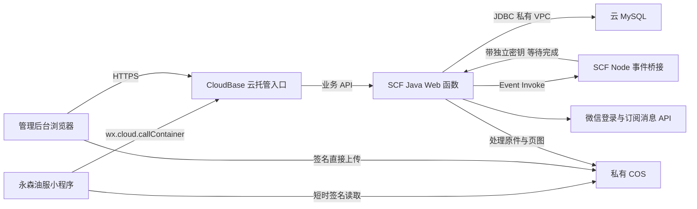

# 微信云开发接入与部署说明

更新：2026-10-18。当前已采用并部署 **CloudBase 云托管入口 + 独立按量 SCF Java 后端 + CloudBase MySQL + 私有 COS**。免费环境优先，未升级套餐。资源、版本和验收证据以 [云部署执行记录](12-cloud-deployment-status.md) 为准；本文描述可复现的部署方式。

## 1. 架构与选择依据



当前 CloudBase 体验版云托管的 VPC 配置实测未生效，Java 无法直接访问 MySQL。独立 SCF 绑定同一 VPC 后已完成真实 JDBC 和材料处理。采用轻量入口保留官方小程序 `callContainer` 和无自有域名的 HTTPS 管理页面，同时复用现有 Java 事务、审计与持久作业代码，没有为本 MVP 改写数据库接口或购买标准版。[云托管 VPC 说明](https://docs.cloudbase.net/run/deploy/networking/vpc)。

小程序身份仍为 `wx.login → 服务端 code2Session → 系统 token → 员工邀请码绑定`。公网头里的 openid 不作为可信身份；网关不传入外部身份头。视频与 PDF 原件直接上传 COS，业务 API 不代理文件。PDF 转页图、通知执行通过持久作业触发独立事件函数，worker 完成后才确认事件，避开云托管短请求时间限制。

## 2. 当前资源与费用约束

| 项目 | 当前配置 |
| --- | --- |
| 环境 | `yongsen-training-d0eldief700a7cd`，上海体验版 |
| 云托管服务 | `yongsen-api`，0.25 CPU / 0.5 GB，最小实例 0、最大 1 |
| Java SCF | `yongsen-training-api`，3072 MB，执行 780 秒、初始化 90 秒、临时磁盘 2048 MB，并发上限 4 |
| 事件 SCF | `yongsen-training-jobs`，Nodejs20.19，128 MB，900 秒，并发上限 1，重试 2 次，TTL 3600 秒 |
| MySQL | `cynosdbmysql-d1043vmo`，0.25–0.5 CPU / 1 GB，30 分钟无访问自动暂停，公网关闭 |
| 私有网络 | `vpc-481u4ax8 / subnet-269ld31z` |
| 对象存储 | 私有 COS，同上海地域；实际桶名见部署记录 |

没有预置并发、定时轮询、CFS 或额外 API 网关。独立 SCF 的按量费用不自动包含在 CloudBase 免费额度里；20 元/月是此前基础套餐目标，并非总费用硬上限。是否转付费及具体价格需要按实际购买页和账单核对，不能将体验版长期视作永久免费。[套餐权益](https://cloud.tencent.com/document/product/876/127357)、[SCF 定价](https://cloud.tencent.com/document/product/583/12281)。

## 3. 构建与发布

1. 运行本地验收。当前本机 Maven 镜像使用独立设置，避免内网镜像影响构建：

   ```sh
   TRAINING_MAVEN_SETTINGS="$PWD/.local/serverless-maven-settings.xml" npm run verify
   node scripts/package-serverless.mjs
   ```

2. 源码归档只包含白名单文件。使用 `deployment/serverless/Dockerfile` 在 Linux amd64 构建镜像；当前通过已授权官方 CloudBase CLI / MCP 上传源码并云端构建。构建时不提供任何业务秘密。记录真实部署版本的 buildId，不能将首次请求返回的旧版本任务 ID 当成新构建成功。
3. Java SCF 使用镜像默认 `/opt/yongsen/scf_bootstrap` 入口、9000 端口、`serverless` profile，配置 VPC、公网出口、并发上限与私密环境变量。应用不自动建表；正式空库使用 `backend/schema-mysql.sql` 初始化，禁止导入本地测试数据。
4. Node 事件桥接上传 `event-bridge.zip`，处理器 `index.main_handler`。配置固定 Java 函数 HTTPS origin 与独立 worker 密钥；事件只携带持久作业 ID，不能指定 URL 或密钥。开启有限错误重试，不设定时触发器。
5. 云托管使用同一构建定义产出的镜像，可独立于 Java SCF 更新网关版本，覆盖 `EntryPoint=["/usr/local/bin/node"]`、`Cmd=["/opt/yongsen/cloudbase-gateway.cjs"]`，环境变量仅需 `TRAINING_UPSTREAM_BASE` 指向 Java SCF HTTPS origin。静态页面位于 `/opt/yongsen/web`。网关无 MySQL / 微信秘密。端口 9000，启用 PUBLIC / MINIAPP。
6. 真实健康、管理员登录、业务 API、COS 上传与异步处理通过后，再上传小程序体验版。Java 更新检查镜像 digest；桥接更新检查 ZIP SHA-256，单独修复桥接无需重建 Java 镜像。

网关同时向 SCF 发出最多 3 个请求、总在途上限 32，业务请求上限 19 MiB、排队与执行总超时 55 秒，拒绝本地模拟与内部 worker 路径；保留 Bearer、幂等键、Range 和必要下载响应头。长任务走 SCF 直达 worker，不经网关。完整环境变量、COS CORS、生命周期和故障处理约束见 [运行手册](../deployment/serverless/README.md)。

## 4. 数据与权限

- 正式 MySQL schema 已初始化 20 张 InnoDB 表；业务账号 `yongsen_app` 仅目标库四项 DML 权限、最大连接数 20。Java 使用短连接释放策略，空闲暂停及醒后重连仍须实际验证。
- 当前 MySQL 握手不支持 TLS，控制台 SSL 操作不可用。应用保持 Connector/J 默认 PREFERRED，通过私有 VPC 连接；这不构成数据库 TLS 验收。没有开放公网或关闭证书校验。
- 业务 API-only 子账号仅 COS 指定桶两个业务前缀与 SCF Invoke 操作权限。官方 Invoke 只支持操作级授权，不宣称限定单函数。部署 CLI 使用官方服务角色，业务程序不使用主账号或部署会话 token。
- 管理员、MySQL、AppSecret、数据加密、worker 和回调凭据存于本机 0600 私密文件及对应云端运行配置。镜像、源码包、小程序只含公开配置。
- COS 私有桶的 CORS 允许实际管理后台 origin 和必要签名头。`uploads/` 1 天自动清理，`materials/` 无过期策略；上传后后端核验原件、散列、媒体属性与页图，READY 后仍需管理员确认手机兼容性才可发布。

## 5. 微信项目关联与上传

按 [微信官方快速开始](https://developers.weixin.qq.com/miniprogram/dev/wxcloudservice/wxcloud/quick-start/miniprogram.html)接入云开发。已有腾讯云环境时不重复创建：先将永森油服小程序关联当前腾讯云账号，再在微信开发者工具云开发环境管理中选择已有腾讯云环境。[关联已有环境](https://cloud.tencent.com/document/product/876/57380)。

此前 `callContainer` 返回 `INVALID_HOST`，尚未到达业务后端。用户随后已反馈完成身份验证并同意关联永森油服；最终小程序关联结果尚未读回，需先核验关联和实际云调用，不能据此认定已经连通。小程序云调用无需额外 API 合法域名；COS 视频、页图及下载域名需另外核验。[CloudBase 小程序调用](https://docs.cloudbase.net/run/develop/access/mini)。

生成生产工程：

```sh
npm --prefix miniprogram run build:production -- --transport cloud \
  --env yongsen-training-d0eldief700a7cd --service yongsen-api \
  --public-https https://yongsen-api-330499-11-1304903095.sh.run.tcloudbase.com
```

生产工程不覆盖开发配置，不复制私密文件，保持合法域名检查。当前 `miniprogram/release/production-3XjvzA` 已导入工具并编译，尚未上传。通知模板已在后端保存：新任务发布通知、`thing1 → title`、`time20 → dueAt`，所有下发任务需要截止时间。公众平台消息回调还未配置，GET 签名自检成功不代表微信正式回执已接通。

## 6. 验收门槛

| 范围 | 已有证据 | 剩余 |
| --- | --- | --- |
| 本地 | 后端、Web、小程序逻辑、部署契约、Chromium E2E、隔离 MySQL、备份恢复通过 | 不替代真实微信 |
| 云后端 | 管理员登录、鉴权、数据库读写、MP4/PDF 上传处理散列与授权读取通过 | 数据库暂停唤醒、并发事务、云端备份恢复 |
| 微信 | 真实 AppID、模板、云配置，生产工程已编译 | 环境关联、真实登录、员工绑定、手机学习、确认及导出 |
| 通知 | 后端配置已应用、回调签名自检通过 | 用户订阅、真实收件、回执状态和点击正确任务 |
| 费用 | 未升级，资源上限已设 | 实际账单与长期预算核对 |

最新测试和发布摘要统一保存在 [云部署执行记录](12-cloud-deployment-status.md)，避免将控制台服务正常、本地模拟送达或未发布的素材样本写成整体 MVP 验收完成。
