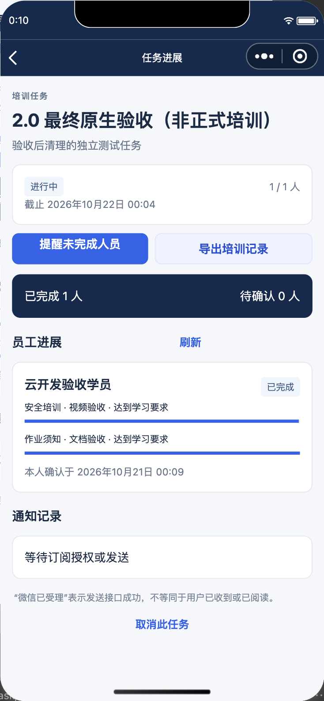
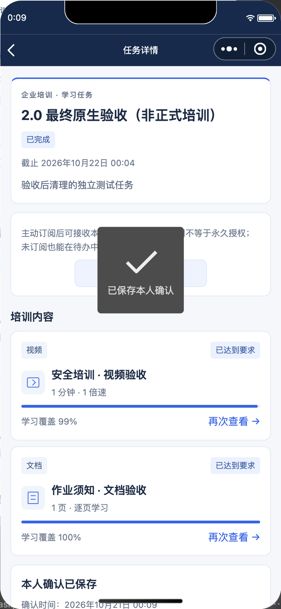

# 2.0 重构、部署与验收记录

验收时间：2026-10-20 至 2026-10-21，时区 Asia/Shanghai。

**已完成代码重构、真实 CloudBase 部署、微信 2.0.0 开发版上传，以及原生开发者工具中的完整学习流程验收。尚未完成公众平台正式发布、真机订阅消息送达与点击跳转验收，也未自动导入完整的平台成员名单。**

## 交付范围

小程序同时承载管理员和员工功能，通过 `wx.cloud` 访问文档数据库、云存储和三个托管云函数。旧 Java 后端、Web 管理端、HTTP 网关部署代码和 MySQL 接口已从当前代码删除；没有旧数据迁移、旧接口兼容或回退通道。历史说明归档在 `docs/history/`。

已实现员工邀请与绑定核对、成员权限核验、视频/PDF 上传处理、任务草稿与发布、订阅通知队列、学习过程校验、本人确认、记录查询、管理员进度监控和 CSV 生成。管理员和项目成员均映射到 `ADMIN`，其他账号默认 `USER`。

架构与操作说明见 [CloudBase 直连架构](16-cloudbase-direct-architecture.md)。

## 部署结果

| 项目 | 已验证结果 |
| --- | --- |
| 腾讯云目标账号 | `100009518543`，部署前通过 STS 核对 |
| 小程序 AppID | `wx505c1dc50f1f7099` |
| CloudBase | `yongsen-prod-d4ghriorcc1483d38`，上海 |
| 文档数据库 | 新 `ys_` 集合、索引、读写规则已部署 |
| 云存储 | 默认拒绝客户端读写；管理员通过云端签发的对象凭据直接上传 |
| 培训函数 | `ys-training`，Node.js 20.19，512 MB，60 秒 |
| 教材函数 | `ys-materials`，Node.js 20.19，2048 MB，180 秒，原生 PDF 渲染自检通过 |
| 作业函数 | `ys-jobs`，Node.js 20.19，512 MB，180 秒 |
| 调度 | `training-every-minute` 已启用，每分钟执行；实际完成教材处理及任务分配 |
| 云函数权限 | 培训函数要求非匿名登录；作业、教材函数禁止客户端调用；环境规则回读一致 |
| 微信 OpenAPI | 使用官方 CLI 注册 `subscribeMessage.send` 权限，实际调用已到达微信订阅接口 |
| 小程序上传 | 官方 CLI 上传 `2.0.0` 成功，包大小 89,993 字节；构建开启合法域名校验 |
| 通知跳转版本 | 当前为 `developer`；正式发布后需切换到 `formal` |

运行包的源代码 SHA-256 与本地构建逐一比对通过，完整值见 [部署回读证据](evidence/20261021-cloudbase-v2/deployment.json)。微信上传回执见 [开发版包信息](evidence/20261021-cloudbase-v2/upload.json)。

本次发现并修复了部署过程中的实际问题：配置更新重复触发依赖安装时，运行包可能仍为旧版本。部署现采用配置更新与代码安装分离、ZIP 上传、运行哈希回读和渲染自检。仅收到部署成功或 Active 不算验收通过。

## 测试结果

| 验证内容 | 结果与范围 |
| --- | --- |
| 自动化测试 | 34 项通过：云端领域/权限 10 项，小程序协议/学习采集/构建 24 项 |
| 语法与变更检查 | 29 个 JavaScript 源文件语法检查通过，`git diff --check` 通过 |
| 凭据检查 | 新源代码、配置未发现硬编码云密钥或 AppSecret；私有凭据及构建目录不纳入 Git |
| 普通用户越权 | 同一真实微信账号临时切为 USER：管理命令被拒绝，跨用户分配查询被拒绝，测试后恢复 ADMIN |
| 客户端直接改角色 | 数据库返回权限拒绝 `-502003` |
| 伪造后台调度 | 客户端调用 `ys-jobs` 被平台规则拒绝 `-501023`；函数内部也有可信来源校验 |
| 真实上传 | 原生客户端向签名对象地址上传返回 HTTP 200，合法域名校验开启 |
| 教材处理 | 实际 H.264 MP4 解析、PDF 页图渲染通过；失败作业重试由真实分钟定时器完成 |
| 任务分配 | 创建全新任务后等待真实分钟调度，员工可见任务生成成功 |
| 视频学习 | 原生 video 实际播放 12 秒视频，由云端校验覆盖范围；没有注入伪造播放事件 |
| PDF 学习 | 原生页图实际显示、读取可见范围，累计至少 30 秒后达标 |
| 完成确认 | 实际点击本人确认，云端产生完成记录，个人记录页可见 |
| 管理员页面 | 实际填写任务名称、勾选教材与员工、保存草稿、点击发布通过；完成详情显示已完成 1 人 |
| 清理后可用性 | 测试数据删除，管理员权限保留，测试员工绑定解除；空工作台登录另有回读记录 |

最终原生学习验收在 2026-10-21 00:07:49 至 00:09:19 完成。证据见 [学习流程结果](evidence/20261021-cloudbase-v2/native-e2e.json)、[管理页面结果](evidence/20261021-cloudbase-v2/admin-e2e.json)、[权限实测](evidence/20261021-cloudbase-v2/permissions.json)、[定时教材处理](evidence/20261021-cloudbase-v2/scheduler.json)。





上述原生验收使用官方微信开发者工具、真实云环境和一个真实微信账号顺序切换角色；不等同于两部手机、两个独立微信账号或 iOS/Android 真机兼容性验收。视频允许规则内的首尾采样容差，因此页面可能显示 99% 覆盖但已达到要求；内部缺口不能直接通过。

## 尚未完成的发布验收

1. **正式发布。** 本次微信管理页的浏览器操作被工具限制阻止，已停止该操作。官方开发者工具 CLI 已完成开发版上传，但未设置 2.0.0 体验版、提交审核或正式发布。使用当前应用令牌调用官方代码版本查询 API 返回 `40014`，没有取得可用的代码管理接口访问能力，见 [接口回执](evidence/20261021-cloudbase-v2/release-api.json)。旧体验版本不能作为 2.0 的验收入口。已另行生成当前构建的开发版预览二维码，保存在本机 `.local/cloudbase-v2/developer-preview.jpg`。
2. **真机消息闭环。** 开发者工具中的订阅授权没有取得成功回执。补齐 OpenAPI 权限后，对当前测试账号的一条真实发送请求返回 `43101`（用户未接受消息），见 [微信接口结果](evidence/20261021-cloudbase-v2/notification.json)。没有伪造授权、没有把该拒绝算作送达，也没有向其他员工发送验收消息。需要真实微信点击授权、收到卡片并打开正确任务后才能通过。
3. **完整成员核验。** 已依据真实微信身份及当前 AppID 的开发权限初始化当前开发成员。截图中的平台管理员及另一成员的昵称、掩码微信号不能可靠转换为小程序 OpenID；没有猜测绑定。其余成员登录产生核验码后，在小程序「账号权限」中对照公众平台名单设置来源。成员变动也需要同步更新映射，当前未实现自动名单同步。

正式发布前，旧线上基础设施没有删除，以免仍指向旧版本的小程序立即失效；新 2.0 代码没有使用这些服务。发布完成后，可以关闭旧 CloudRun 网关、默认命名空间中的旧 API/作业函数及旧 MySQL。这些旧云资源仍可能产生费用，不能将本次代码删除等同于旧资源销毁。

## 数据清理与复验

已删除本次明确标识的 4 个验收任务、4 份分配、3 份教材及文件、2 条完成记录、1 名虚拟验收员工，以及关联会话、批次、通知和绑定数据。保留经核验的管理员身份、通知模板、权限规则和一条清理审计。新系统的任务、员工、教材、分配、完成记录均为 0，详见 [清理结果](evidence/20261021-cloudbase-v2/cleanup.json)。解除验收员工绑定后，管理员实际登录并点击管理入口成功，见 [清理后复验](evidence/20261021-cloudbase-v2/clean-state.json)。

再次运行原生验收时，先创建员工、完成真实微信绑定、上传教材并发布新任务，然后执行：

```sh
npm test
E2E_ASSIGNMENT_ID=<分配给当前登录微信账号的新任务编号> \
  npm run test:native --prefix miniprogram
```

该命令连接开发者工具自动化端口 `9420`。验收会真正推进指定任务的学习与完成状态；应使用明确标识的验收任务。
