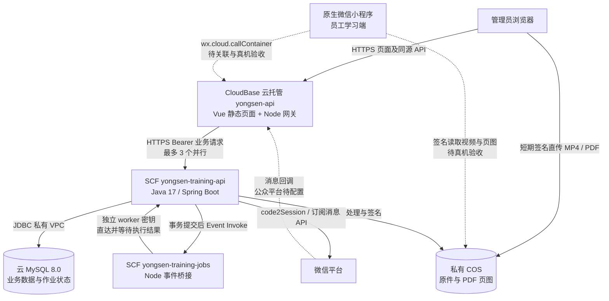

# 永森油服培训平台：当前架构与部署总览

> 最新生产环境已切换为永森账号 `100009518543` 下的 `yongsen-prod-d4ghriorcc1483d38`。真实登录、原生学习、确认及导出已通过；以下旧账号资源和旧验收状态仅保留为历史背景。当前入口、资源及未完成项以 [15 永森账号部署与验收记录](15-yongsen-account-redeployment.md) 为准。

**登录接入更新（2026-10-18）：** 用户没有自有域名，当前工程已切回 cloud 调用。默认云托管域名不能加入正式 request 合法域名，之前的 HTTPS 默认域名方案已撤回。登录流程保持 `wx.login → code2Session → 业务 token`；环境关联与真实登录尚待验证，详见 [14 微信登录流程与排障](14-wechat-login.md)。

整理日期：2026-10-18。本文依据当前源码、构建配置和已保存的云端验收记录，作为后续开发与运维的入口。资源版本对应当日部署读回；本次整理再次请求公网 `/health`，返回 HTTP 200、`UP / real / prod`。云 CLI 当前登录已失效，本轮未重新读取资源配置。

**当前系统是一个 Java 业务应用、两个用户端，加上轻量入口网关和异步执行桥接。** 管理后台、Java API、云 MySQL、COS 和材料异步处理已经部署；小程序生产工程已生成并编译，但环境关联结果、真实微信登录和通知送达尚未验收。因此，云后端可用不等于整个微信 MVP 已发布完成。

## 1. 整体结构



业务逻辑、事务和权限集中在 Java 服务中。两个 Node 组件只负责入口代理与异步调用，不是拆分出来的业务微服务。当前没有 Redis、消息队列集群、独立搜索服务或 CFS。

采用这套组合的实际原因：体验版云托管直连 MySQL 的 VPC 配置未生效，实测连接超时；独立 SCF 绑定 VPC 后已连通。于是保留 CloudBase 的小程序入口与默认 HTTPS 管理地址，将 Java 放在已验证能访问内网数据库的 SCF 中，复用现有业务实现。

## 2. 用户端与业务模块

| 层次 | 技术与代码入口 | 职责 |
| --- | --- | --- |
| 管理端 | Vue 3、TypeScript、Vite；`web/src/admin/` | 工作台、员工与微信绑定核对、教材上传、任务发布、人工催办、记录导出、首次使用教程 |
| 学员端 | 原生微信小程序；`miniprogram/pages/` | 微信登录、邀请码申请绑定、任务列表、视频/PDF 学习、本人确认、学习记录 |
| API 层 | Java 17、Spring Boot 3.5.16；`backend/src/main/java/com/yongsen/training/` | 鉴权、业务规则、学习核验、通知、媒体处理、记录与审计 |
| 数据访问 | Spring JDBC、MySQL 8.0 | 参数化 SQL、事务、行锁、版本冲突检测、持久作业 |
| 文件处理 | ffprobe、Poppler、中文字体 | 视频属性核验、PDF 页数与页图生成；当前不提供视频转码 |
| 发布运行 | Docker、CloudBase 云托管、SCF | 同一构建定义生成镜像，网关与 Java 分别启动；事件桥接单独 ZIP 发布 |

管理端围绕安全生产培训、岗位技能培训、员工能力提升组织页面。这些是同一培训任务模型的业务分类，没有为每种培训另建服务。

### Java 模块对应关系

以下类均位于 `backend/src/main/java/com/yongsen/training/`：

| 模块 | 主要类 | 负责内容 |
| --- | --- | --- |
| 登录和人员 | `ApiController`、`AuthService`、`SecurityConfig` | 管理员登录、微信 code 换身份、系统 token、人员停用、邀请码、绑定核对及撤销 |
| 任务 | `TaskService`、`ApiController` | 草稿、选人选材、发布、取消、人员任务分配及详情 |
| 学习核验 | `LearningService`、`LearningMath` | 会话互斥/接管、事件序列、有效视频区间、PDF 逐页进度、完成确认 |
| 教材 | `MediaController`、`MediaService`、`CosMediaObjectStorage` | 签名直传、对象校验、散列、视频探测、PDF 转页图、授权读取 |
| 微信通知 | `NotificationService`、`WxProvider`、`IntegrationController` | 订阅授权记录、发送、回调解析与关联、打开记录、失败和未知结果处理 |
| 持久作业 | `BackgroundWorkStore`、`BackgroundWorkDispatcher`、`ScfBackgroundInvoker`、`BackgroundWorkController` | 事务入库、提交后触发、租约、游标、终态及管理员恢复 |
| 审计与记录 | `Store`、`RecordRenderer`、`ApiController` | 审计记录、确认快照、CSV 导出和中文个人记录打印 |
| 管理端教程 | `OnboardingService`、`OnboardingController` | 首次使用引导、服务端进度、完成及重新查看 |

浏览器学员预览位于 `web/src/learner/`，只用于本地调试和 E2E。正式个人微信学习入口是小程序，不使用网页模拟身份代替微信登录。

### 小程序页面

`login` 登录与绑定 → `tasks` 我的任务 → `task` 任务详情和接收微信提醒 → `learn` 视频/PDF 学习 → `records` 学习记录。

`lib/transport.js` 统一封装本地 `wx.request` 与生产 `wx.cloud.callContainer`；`lib/api.js` 处理业务 token 与错误；`lib/session-tracker.js` 采集学习事件。生产生成目录使用真实 AppID、cloud transport、环境 ID 和服务名，不包含 AppSecret。

## 3. 核心业务链路

### 3.1 登录与人员身份

管理员建员工并生成个人邀请码。员工进入小程序调用 `wx.login`，Java 用 code 向微信换取身份，再签发本系统 token；员工提交邀请码申请绑定，管理员核对通过后才取得对应人员的学习权限。人员停用或绑定撤销后阻止继续学习。网关传入的外部 openid 身份头不作为登录凭据。

首次接入仍需要管理员把小程序入口和个人邀请码交给员工，例如由管理员发送到已有微信工作群或私聊。系统不能在员工从未进入、绑定和主动订阅时，凭手机号直接发微信订阅消息。

### 3.2 教材与任务发布

1. 管理端申请上传凭据，文件通过短期签名直接 PUT 到私有 COS 的 `uploads/`。
2. 上传确认后，Java 持久化教材处理作业，事务提交后调用 Event 函数。
3. Event 桥接请求 Java 内部 worker，等待视频探测或 PDF 渲染完成；原件和页图存入 `materials/`，MySQL 保存对象引用、散列及处理结果。
4. 教材达到 READY 后仍需管理员预览和确认手机兼容性，才能选入任务。
5. 发布时固定人员、教材版本和学习规则，生成每位员工的任务分配记录及相应通知记录。

文件不经过云托管网关上传，也不把函数临时磁盘作为教材持久存储。

### 3.3 微信通知

员工主动点击“接收微信提醒”取得订阅授权；后端按授权情况执行首次通知或管理员人工催办。当前模板为“新任务发布通知”，字段映射 `thing1 → title`、`time20 → dueAt`，所以下发任务需要截止时间。

系统分别记录授权、发送尝试、接口接受结果、可关联的微信回执和任务打开时间。未知发送结果不自动当作失败重发，也不改记为送达；再次催办需要新授权及相应确认。当前是一次性订阅，不代表永久允许向员工推送。

模板已配置，公众平台回调及真实手机收件还未验收。回调签名自检通过，仅说明后端入口能处理该校验。

### 3.4 学习与完成记录

小程序采集播放、停留、前后台及可见范围等事件，后端根据事件序列和服务端规则计算进度。视频去重计算有效观看区间，PDF 核验逐页前台停留与可见区域；断网、无确认响应或异常切换按已有规则暂停，不补造学习时间。全部材料满足要求后，学员本人确认，保存完成快照，供后台查询、CSV 导出及打印。

记录可以证明系统观察到的学习过程及其完成判定，不能绝对证明持续专注、理解或代替实操考核。当前没有第三方时间戳或不可篡改存证服务。

### 3.5 异步作业与恢复

作业类型为教材处理 `MEDIA` 与通知批次 `NOTIFICATIONS`。作业与业务变化一起持久化，事务提交后才触发 Event；事件只传作业 ID，不能指定任意 URL。桥接使用固定地址和 worker 密钥，等待 Java 完成才确认事件。数据库租约、终态和通知自身状态共同控制重复执行。

平台重试次数有限，无法执行的作业保留数据库状态，管理员通过后台查看并恢复。生产不依赖定时轮询或请求结束后的进程内后台线程，也没有无限自动重试。

## 4. 数据存储与环境隔离

生产 schema 见 [backend/schema-mysql.sql](../backend/schema-mysql.sql)，共有 **20 张 InnoDB 表**：

| 分组 | 表 |
| --- | --- |
| 账号与身份 | `admin_user`、`person`、`wx_identity_binding`、`auth_token` |
| 教材与任务 | `material`、`task`、`task_material`、`assignment`、`media_ticket` |
| 学习过程 | `learning_session`、`learning_event`、`learning_progress` |
| 通知 | `notification`、`notification_attempt`、`subscription_record`、`wechat_callback` |
| 管理与执行 | `audit_log`、`app_config`、`background_work` |
| 本地模拟支持 | `mock_card`；生产禁止模拟入口，不用该表证明真实送达 |

数据访问以结构化领域列为准，`snapshot_json` 保留补充快照。文件二进制放 COS，MySQL 保存业务元数据与引用。当前未引入独立数据库迁移框架：新库执行 schema；已有库须先备份，再按变更执行迁移，不能用初始化脚本代替完整版本迁移。

| 项目 | 本地开发/验收 | 当前云部署 |
| --- | --- | --- |
| 数据库 | H2；另有隔离 MySQL 专项 | 内网 MySQL 8.0 |
| 材料 | 独立本地数据目录 | 私有 COS；`/tmp` 仅处理缓存 |
| 微信 | 模拟渠道 | 真实 API 配置，待手机闭环 |
| 后台任务 | 本地调度/测试模式 | 持久作业 + SCF Event |
| 服务入口 | Web 5173、API 8080 | HTTPS 网关、内部函数 9000 |
| 初始化 | 本地 schema | `serverless` 禁止自动初始化生产库 |

本地验收使用独立端口和数据目录，不导入云端业务库。`DriverManagerDataSource` 在数据库操作或事务结束后关闭物理连接，以免冻结实例中的连接池阻止 MySQL 暂停；实际闲置后应用唤醒仍需专项验收。

## 5. 已部署资源与版本

管理入口：[永森油服培训管理后台](https://yongsen-api-330499-11-1304903095.sh.run.tcloudbase.com/#admin)。

| 组件 | 当前资源 / 参数 | 发布单元 |
| --- | --- | --- |
| CloudBase 环境 | `yongsen-training-d0eldief700a7cd`，上海，免费体验版 | 环境配置 |
| 入口网关 | `yongsen-api`，0.25 CPU / 0.5 GB，实例 0–1，9000；PUBLIC / MINIAPP | 镜像版本 **005**，Node 入口 |
| Java API | `yongsen-training-api`，3072 MB，执行 780 秒，初始化 90 秒，临时磁盘 2048 MB，总并发上限 4 | 镜像版本 **004**，Java 入口 |
| 事件桥接 | `yongsen-training-jobs`，Nodejs20.19，128 MB / 900 秒，并发 1，错误重试 2 次，TTL 3600 秒 | 独立 ZIP，`index.main_handler` |
| 数据库 | `cynosdbmysql-d1043vmo`，`172.17.0.10:3306`，0.25–0.5 CPU / 1 GB，30 分钟空闲自动暂停，公网关闭 | schema 与数据 |
| 网络 | `vpc-481u4ax8 / subnet-269ld31z`；Java SCF 绑定该 VPC 并开启所需公网出口 | 网络配置 |
| COS | `796f-yongsen-training-d0eldief700a7cd-1304903095`，上海私有桶 | 对象、CORS、生命周期 |
| 小程序 | AppID `wx505c1dc50f1f7099`；已生成 `miniprogram/release/production-3XjvzA` 并编译 | 独立小程序包，未上传体验版 |

Java SCF 固定 HTTPS origin：`https://1304903095-gfmwytb7n6.ap-shanghai.tencentscf.com`。平台 URL 允许公网访问，业务 API 仍强制本系统 Bearer、角色和任务归属鉴权；worker 使用独立密钥。Event 直接访问该地址执行 worker，不经过网关的短请求截止时间。

### 当前并发约束

网关最多向 SCF 建立 **3 条并行连接**，活动与排队合计最多 **32 个请求**，排队和执行共 **55 秒截止时间**。这样在网关最多 1 个实例、Java 并发上限 4 的前提下，为 Event worker 留出一个执行槽位。队列满返回 503，不重放员工创建等写入请求。

该约束用于修复工作台并发加载触发 SCF 432 的问题；不是高并发容量承诺。未来增加网关实例数或其他直连 API 调用方，必须重新计算总并发。小程序 API 目前请求超时为 8 秒、学习无 ACK 10 秒暂停；云端一次批量请求最长曾达 20.7 秒，冷启动与真机首次请求体验仍需专项验证。

完整镜像地址、digest、源码归档 SHA、事件 ZIP SHA 和测试证据统一保存在 [12 云部署执行记录](12-cloud-deployment-status.md)，避免多处维护长版本号。

## 6. 构建和发布方式

### 6.1 本地开发与验收

从工程根目录执行：

```sh
npm ci
npx playwright install ffmpeg
npm run setup
npm run dev
```

前置依赖为 Java 17、Maven、受支持的 Node.js、npm、ffmpeg/ffprobe、Poppler 和 Google Chrome，详见 [本地运行说明](05-local-and-wechat-setup.md)。改 Java 后需要重建并重启，Web 开发模式自动更新。

提交发布前执行：

```sh
npm run verify
npm run verify:mysql
node scripts/package-serverless.mjs
```

`verify:mysql` 需要本机可执行 `mysqld` 和 `mysql`；[专项脚本](../scripts/verify-mysql.mjs)自动创建独立数据目录及本地实例，默认使用 MySQL 13368、API 18082，不连接已有生产库。当前本机如需绕开公司 Maven 镜像，可使用已准备的 `TRAINING_MAVEN_SETTINGS="$PWD/.local/serverless-maven-settings.xml"` 运行验收；此路径是本机配置，不是其他机器的通用前提。

`verify` 覆盖后端、Web、小程序逻辑、部署契约、本地真实 Chrome E2E 和停机备份恢复。结果写入 `.local/verification/<时间>/`。打包脚本仅输出白名单源码包、事件 ZIP、manifest 与 SHA256SUMS 到 `.local/serverless-artifacts/<时间>/`，不会自动创建云资源或部署。

### 6.2 服务器镜像

[deployment/serverless/Dockerfile](../deployment/serverless/Dockerfile) 是当前唯一使用的服务器镜像构建定义：

1. Node 22 阶段构建 Vue，API 基址固定为同源 `/api/v1`。
2. Maven / Java 17 阶段构建 Spring Boot jar，并包含 Web 静态资源。
3. 运行镜像包含 JRE、Node、Vue 静态文件、ffmpeg、Poppler、中文字体及两个启动入口，以非 root 用户运行。

当前实际发布通过已授权的官方 CloudBase CLI / MCP 上传白名单源码并云端构建 Linux amd64 镜像。构建不注入业务秘密。也可在受控 Docker 环境使用同一源码包构建：

```sh
docker build --platform linux/amd64 \
  -f deployment/serverless/Dockerfile -t "$TRAINING_SCF_IMAGE" .
docker push "$TRAINING_SCF_IMAGE"
```

其中 `TRAINING_SCF_IMAGE` 必须是已准备仓库中的新版本标签；仓库认证通过私密登录配置。构建流程跳过镜像内测试，发布前必须先通过上面的独立验收。

### 6.3 三个服务分别部署

| 发布目标 | 入口及配置 | 更新后核验 |
| --- | --- | --- |
| Java SCF | 使用镜像默认 `/opt/yongsen/scf_bootstrap`；9000；`serverless` profile；VPC、资源限制和私密环境变量 | Active、正确镜像 digest、冷启动、真实鉴权 API、数据库读写 |
| Event SCF | 上传 `event-bridge.zip`；`index.main_handler`；固定 `TRAINING_WORKER_BASE_URL` 和 worker 密钥 | 实际 Event 执行；数据库作业终态；不能只看 Invoke 接受成功 |
| CloudBase 网关 | 镜像覆盖 `EntryPoint=["/usr/local/bin/node"]`、`Cmd=["/opt/yongsen/cloudbase-gateway.cjs"]`；`TRAINING_UPSTREAM_BASE` 指向 Java SCF | 新构建成功、版本正常、流量切换、静态页面与同源 API |

网关只需要上游地址，不需要数据库密码、微信 AppSecret 或云账号密钥。Java 与网关可使用同一镜像，也可以保留不同已验证版本；当前 005 网关 / 004 Java 就是独立发布结果。改桥接只发布 ZIP，改小程序只重新构建和上传小程序包。

已有部署的更新流程是：**验证 → 白名单打包 → 构建并记录摘要 → 发布受影响组件 → 读取实际版本/流量 → 业务验收 → 更新部署记录**。没有自动监听 Git 的流水线，也没有“一条脚本已经完成所有云资源配置”的能力；本地脚本负责验证与打包，资源发布由官方云工具执行。源码统一纳入 [GitHub 仓库](https://github.com/chlde/yongsen-miniprogram)，后续以提交号配合源码包、manifest、镜像 digest 和验收记录追溯版本。已有云端版本早于首次 Git 归档，其版本仍以当时记录的摘要为准。

首次新环境还需在发布前建立私有网络、MySQL 空库与 schema、COS 和最小权限账号。具体创建顺序及环境变量逐项说明见 [11 部署步骤](11-wechat-cloudbase-deployment.md) 和 [服务器运行手册](../deployment/serverless/README.md)。

### 6.4 小程序独立发布

```sh
npm --prefix miniprogram run build:production -- --transport cloud \
  --env yongsen-training-d0eldief700a7cd --service yongsen-api \
  --public-https https://yongsen-api-330499-11-1304903095.sh.run.tcloudbase.com
```

将命令输出的 `miniprogram/release/production-*` 目录导入微信开发者工具，确认账号和云环境关联、保持合法域名校验，配置 COS 媒体/下载域名以及消息回调。随后上传体验版，验证指定个人微信的登录、绑定、订阅、收件、跳转、学习、本人确认和后台导出，再提交审核及正式发布。服务器部署成功不会自动发布小程序。

### 6.5 回滚与数据保留

网关或 Java 发布失败时，分别切回对应上一个已验证镜像；桥接恢复上一份已归档 ZIP。回滚前先确认接口和数据库变更向后兼容。数据库迁移不会随镜像自动撤销，不使用覆盖生产库的方式回滚。正式教材、人员与学习记录不随发布清空。

数据密钥、对象存储和数据库需要配套备份；本地停机备份恢复已测试，云数据库与 COS 的整体恢复尚未验收。这里描述的是运维要求，不代表已有自动化云灾备。

## 7. 权限、费用与当前验收范围

运行秘密只存在本机受限私密文件和对应云端配置，不写入源码包、小程序或本文。MySQL 业务账号仅目标库四项 DML 权限、最大连接数 20；COS 业务权限限定指定桶的 `uploads/`、`materials/`，`uploads/` 一天到期清理，正式教材不设自动过期。网关屏蔽本地模拟、内部 worker 路径及外来身份头。

数据库公网关闭，走 VPC；已观察到当前实例握手不支持 TLS，不能将“私有网络”写成“数据库链路已验证 TLS 加密”。SCF Invoke 权限受平台授权粒度限制，当前为操作级授权，不宣称限定到单函数。

费用按资源分别核算：CloudBase 目前是体验版；独立 SCF 的调用、执行、流量和适用的临时磁盘费用，以及云 MySQL、COS 存储和访问费用，需结合实际套餐权益与账单核对。没有开启预置并发、常驻实例或定时轮询；此前约 20 元/月是基础档目标，**不是整套系统的费用上限**。本文不把历史预算单价当作当前报价。

| 范围 | 已有结果 | 待完成 |
| --- | --- | --- |
| 本地 | 后端 175 项常规测试、Web 10、小程序逻辑 34、部署契约 23、Chrome E2E 16、备份恢复通过；MySQL 专项另有记录 | 本地微信为模拟 |
| 云端管理与材料 | 管理登录、权限、员工创建读回、数据库读写、MP4/PDF 直传与异步处理、签名读取通过；432 修复后 30 次 API 请求均 200 | 远程页面点击、冷启动体验与更大负载验证 |
| 微信 | AppID、订阅模板已配置；生产工程已编译 | 用户已反馈完成身份验证并同意关联，最终关联结果尚无读回；真实登录、订阅、收件和完整学习闭环待验收 |
| 运维 | 资源上限、私有存储与运行权限已设置 | 应用闲置后数据库唤醒、云端故障及备份恢复、实际费用核对 |

后续验收应先完成微信关联与体验版闭环，再补齐冷启动、数据库恢复和账单核验。当前不应把“后端部署正常”或“发送接口接受”标为整个 MVP 发布完成。

## 8. 工程目录与阅读顺序

```text
永森油服小程序/
├── backend/                    Java 业务应用、配置、测试与 MySQL schema
├── web/                        Vue 管理后台与本地学员预览
├── miniprogram/                原生小程序、采集器、生产包构建
├── deployment/serverless/      当前 Dockerfile、网关、SCF 启动与事件桥接
├── deployment/                另保留早期容器方案，不能混用于当前入口
├── scripts/                    安装、启动、验收、样本和白名单打包
├── tests/e2e/                  真实浏览器端到端场景
├── docs/                       产品、接口、部署和验收文档
└── .local/                     本机数据、证据、构建与私密配置；不整体共享
```

- 了解系统：本文 → [01 产品范围](01-product-and-architecture.md) → [02 学习与通知规则](02-learning-and-notification.md)。
- 开发接口：[运行接口契约](runtime-api.md) → [03 数据设计](03-data-and-api.md) → 对应源码与 schema。
- 运维发布：[11 部署步骤](11-wechat-cloudbase-deployment.md) → [服务器运行手册](../deployment/serverless/README.md) → [12 已部署版本与证据](12-cloud-deployment-status.md)。
- 历史演进：[09 早期费用选型](09-serverless-cost-plan.md)、[10 适配阶段验收](10-serverless-implementation-report.md)保留阶段结论，当前部署状态以本文和 12 为准。
